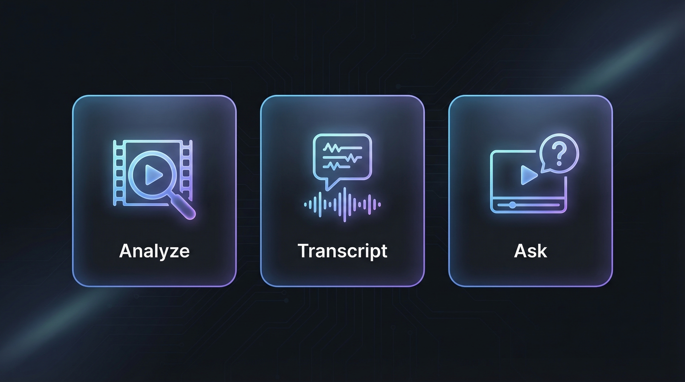
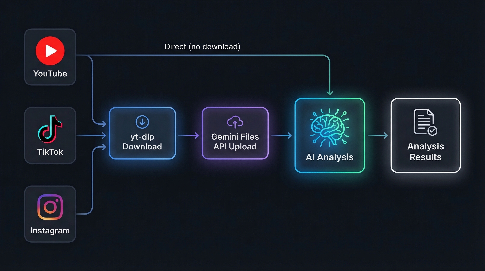

<!-- mcp-name: io.github.u2n4/video-url-analyzer-mcp -->
<p align="center">
  
</p>

<h1 align="center">Video Analyzer MCP Server</h1>

<p align="center">
  <strong>Analyze any video with AI — YouTube, TikTok & Instagram</strong><br>
  Powered by <a href="https://ai.google.dev/gemini-api">Google Gemini 3.8 Flash</a> &middot; <a href="https://github.com/jlowin/fastmcp">FastMCP</a> &middot; <a href="https://github.com/yt-dlp/yt-dlp">yt-dlp</a>
</p>

<p align="center">
  
  
  
  
  
</p>

<p align="center">
  <a href="#features">Features</a> &middot;
  <a href="#architecture">Architecture</a> &middot;
  <a href="#quick-start">Quick Start</a> &middot;
  <a href="#integration">Integration</a> &middot;
  <a href="#security">Security</a> &middot;
  <a href="#%D8%A7%D9%84%D8%B9%D8%B1%D8%A8%D9%8A%D8%A9">العربية</a>
</p>

---

## Features

<p align="center">
  
</p>

v1.6.0 exposes **18 MCP tools**:

| Tool | What it does |
|------|-------------|
| `analyze_video` | Full audio + visual analysis with custom prompts. Uses Gemini multimodal understanding. |
| `get_transcript` | Extract timestamped transcript with speaker identification. Supports 100+ languages via auto-detection. |
| `ask_about_video` | Ask any question about the video content. |
| `prepare_slideshow_assets` | Return ordered slideshow images as MCP image blocks so Claude/the client AI can inspect them directly. |
| `find_video_moments` | Find matching moments with compact/standard/full structured output. |
| `analyze_video_segment` | Analyze only a selected time range. |
| `prepare_video_context` | Analyze once and save a reusable local context for follow-up questions and evidence lookup. |
| `ask_video_context` | Answer from saved context by default; Gemini reanalysis is explicit opt-in. |
| `list_video_contexts` | List saved local contexts. |
| `delete_video_context` | Delete one saved context. |
| `get_video_frame` | Extract a local still frame, using the YouTube fast path when possible. |
| `get_video_clip` | Extract a short local clip, with a 30s cap and YouTube fast path when possible. |
| `get_video_evidence_asset` | Select saved evidence and return a frame or clip reference. |
| `list_video_sources` | Inspect local source/context/asset cache metadata. |
| `cleanup_video_cache` | Dry-run or clean managed cache files; dry-run is the default. |
| `watch_and_analyze` | Extract tutorial steps, shell commands, code snippets, and file paths from technical videos. |
| `execute_tutorial_steps` | Validate and review extracted steps safely; executes only with confirmation. |
| `check_analysis_job` | Poll background job status for TikTok/Instagram async downloads. |

### Supported Platforms

| Platform | Method | Speed |
|----------|--------|-------|
| **YouTube** | Direct Gemini analysis — no download needed for analysis. Frame/clip extraction uses `yt-dlp -g` stream URLs + ffmpeg when available, with a small section-download fallback. | Instant / fast local extraction |
| **TikTok** | tikwm.com API (fast) &#8594; yt-dlp fallback with a safe MP4 H.264/H.265 selector that avoids unsupported ByteDance `bvc2`/`bytevc2` streams when possible | ~8s |
| **Instagram** | Page scrape via curl_cffi (fast) &#8594; yt-dlp fallback | ~10s |

#### Photo / Slideshow Posts

| Platform | Post type | Handling |
|----------|-----------|----------|
| **TikTok** | Photo Mode slideshow | Downloads all images, extracts the music/audio track when available, and sends one multimodal Gemini request. |
| **Instagram** | Carousel / single-photo posts | Downloads image slides in order and analyzes them as one post; mixed video slides are skipped with metadata. |
| **YouTube** | Community `/post/` image attachments | Scrapes `ytInitialData`, downloads image attachments, and analyzes them through Gemini Files API. |

> YouTube videos are analyzed directly through Gemini's native video understanding — zero download, zero upload, maximum speed.
> For YouTube evidence assets, `source.mp4` is not always required: saved contexts keep the original URL, so frame/clip tools can use the local stream fast path later.

---

## Architecture

<p align="center">
  
</p>

| Component | Role |
|-----------|------|
| **Gemini 3.8 Flash** | Latest Flash model, the fast default: full audio + visual understanding in a single pass |
| **Gemini 4 Argon** | Latest flagship reasoning model, the deep default for `detail="full"`: text, image, video, audio and PDF input |
| **FastMCP 3.x** | MCP protocol framework over stdio transport |
| **yt-dlp + curl_cffi** | Video download with Chrome browser impersonation to bypass anti-bot. TikTok downloads prefer locally decodable MP4 H.264/H.265 formats and reject ByteDance `bvc2`/`bytevc2` streams. |
| **tikwm.com API** | TikTok fast-path fallback when yt-dlp is WAF-blocked |
| **ffmpeg** | Local frame/clip extraction, including YouTube stream URL extraction without full-video downloads |
| **Background Jobs** | Async threading for TikTok/Instagram to prevent Claude Desktop timeouts. Failed inner results are reported as failed jobs, not completed jobs. |

### Operating Modes

These are behavior modes, not tool names:

| Mode | Behavior |
|------|----------|
| `auto` | Default adaptive behavior: YouTube direct analysis; TikTok/Instagram fast API/scrape then yt-dlp fallback; saved contexts reused when available. |
| `api` | Gemini-backed analysis or reanalysis. This is used by analysis tools and explicit Gemini opt-ins. |
| `client` | MCP client workflow mode: long TikTok/Instagram analysis returns a background `job_id` for polling. |
| `local` | Saved-context, cache, frame, and clip operations that avoid Gemini unless explicitly requested. |

---

## Quick Start

The packaged runtime lives at `src/video_url_analyzer_mcp/server.py`; the
console entry point is `video_url_analyzer_mcp:main`. Pick whichever
install path matches your workflow.

### Option A — one-line Windows installer (recommended for new users)

```powershell
irm https://raw.githubusercontent.com/u2n4/video-url-analyzer-mcp/main/install.ps1 | iex
```

The installer follows the current MCP client pattern: it installs/runs from
PyPI with `uvx`, uses an existing `GEMINI_API_KEY` environment variable when
one is already set, otherwise asks for the key only through a hidden prompt,
and lets the user choose where to register the server:

- Claude Code
- Claude Desktop
- Codex CLI
- Cursor
- Windsurf
- VS Code / GitHub Copilot
- Google Antigravity
- Cline

Do not append your API key to the PowerShell command. If you skip the key,
the installer still registers the server and you can set `GEMINI_API_KEY`
later. If `GEMINI_API_KEY` is already set in your User environment, the
installer will use it directly and print only a masked form like
`AIza...abcd`.

### Option B — `uvx` (no install)

```powershell
uvx video-url-analyzer-mcp
```

Works on Windows / macOS / Linux as long as [uv](https://docs.astral.sh/uv/) is on PATH.

### Option C — Windows wizard from a checkout

```powershell
git clone https://github.com/u2n4/video-url-analyzer-mcp.git
cd video-url-analyzer-mcp
powershell -ExecutionPolicy Bypass -File scripts\install_windows.ps1
```

The wizard:

- Verifies Python 3.10+ and (optionally) `uv`.
- Installs the package as an editable checkout or via `uv tool install`.
- Lets you save `GEMINI_API_KEY` to a User environment variable **or** to a
  gitignored `.env.keys.local`. Keys are never printed; the wizard shows
  only their length.
- Lets you pick a default model via `VIDEO_ANALYZER_MODEL`.
- Runs an offline import smoke test.
- Hands off to `scripts/configure_mcp_clients.ps1` for client setup.

### Option D — Manual install (any OS)

```bash
git clone https://github.com/u2n4/video-url-analyzer-mcp.git
cd video-url-analyzer-mcp
pip install -e .
python -m video_url_analyzer_mcp
```

Get a free key at [Google AI Studio](https://aistudio.google.com/apikey),
then set it once in your shell environment (`setx GEMINI_API_KEY ...` on
Windows, or your `~/.zshrc` / `~/.bashrc` on macOS/Linux). For local dev
only, you can also put it in a gitignored `.env` file in the repo root. The
server reads `.env`. `start.bat` also reads `.env.keys.local`, which the
wizard writes.

### Windows launcher

`start.bat` loads `.env.keys.local` (if present), sets `VIDEO_ANALYZER_MODE=auto`
when it is unset, and runs `python -m video_url_analyzer_mcp`. It sets no model id,
so the model variables from your environment or `.env` apply, as the table below
describes.
Use it as a `command` value in any MCP client that prefers a single
executable.

---

## Integration

Run `scripts/configure_mcp_clients.ps1` for an interactive menu, or copy
the snippets below from `docs/mcp-config-examples.md`. The wizard backs up
existing client config, validates JSON/TOML, and never overwrites unrelated
MCP servers.

Client configs use `video-analyzer` as the local MCP server entry name. The
published package remains `video-url-analyzer-mcp`, and the registry name
remains `io.github.u2n4/video-url-analyzer-mcp`.

### Claude Desktop (`%APPDATA%\Claude\claude_desktop_config.json`)

```json
{
  "mcpServers": {
    "video-analyzer": {
      "command": "uvx",
      "args": ["video-url-analyzer-mcp"]
    }
  }
}
```

The wizard prefers leaving the API key in your OS environment. If you must
embed it, add `"env": { "GEMINI_API_KEY": "YOUR_KEY_HERE" }`.

### Claude Code (CLI)

```bash
claude mcp add video-analyzer --transport stdio -- uvx video-url-analyzer-mcp
```

Or, after `pip install -e .` in the repo:

```bash
claude mcp add video-analyzer --transport stdio -- python -m video_url_analyzer_mcp
```

### Codex CLI (`~/.codex/config.toml`)

```toml
[mcp_servers.video-analyzer]
command = "uvx"
args = ["video-url-analyzer-mcp"]
```

### VS Code / GitHub Copilot MCP

Workspace registration writes `.vscode/mcp.json`:

```json
{
  "inputs": [
    {
      "type": "promptString",
      "id": "video-url-analyzer-gemini-api-key",
      "description": "Gemini API key for video-url-analyzer-mcp",
      "password": true
    }
  ],
  "servers": {
    "video-analyzer": {
      "type": "stdio",
      "command": "uvx",
      "args": ["video-url-analyzer-mcp"],
      "env": {
        "GEMINI_API_KEY": "${input:video-url-analyzer-gemini-api-key}"
      }
    }
  }
}
```

For all clients, restart the application after editing config so the new
MCP server is picked up. Full snippets — including Cursor, Windsurf,
Antigravity (`%USERPROFILE%\.gemini\antigravity\mcp_config.json`), and
Cline — live in [`docs/mcp-config-examples.md`](docs/mcp-config-examples.md).

---

## Usage Examples

```python
# Full video analysis with Gemini 3.8 Flash
analyze_video("https://www.youtube.com/watch?v=dQw4w9WgXcQ")

# Custom analysis prompt
analyze_video("https://www.tiktok.com/@user/video/123",
              prompt="List every product shown and estimate prices")

# Multilingual transcript extraction
get_transcript("https://www.instagram.com/reel/ABC123/", lang="ar")

# Ask specific questions about video content
ask_about_video("https://youtu.be/abc",
                question="What programming language is used in the tutorial?")

# Analyze once, then ask locally from the saved context
prepare_video_context("https://youtu.be/abc", detail="standard")
ask_video_context("https://youtu.be/abc",
                  question="What happens near the end?")

# Extract visual evidence without embedding binary data in the tool output
get_video_frame("https://youtu.be/abc", timestamp="00:30")
get_video_clip("https://youtu.be/abc", start="00:20", end="00:28")

# Watch & build — extract tutorial steps
watch_and_analyze("https://www.youtube.com/watch?v=tutorial123")
```

---

## Security

This server has been hardened against a comprehensive threat model audit:

| Layer | Protection |
|-------|-----------|
| **SSRF** | URL allowlist — only YouTube, TikTok, Instagram domains accepted. Private IPs, localhost, `file://` blocked. |
| **Command Injection** | `shell=False`, no shell. Each tutorial command is parsed once into an argv list (`shlex` on POSIX, `CommandLineToArgvW` on Windows), and that same list is what runs. argv[0] must be a bare program name, so `./git` and `C:\x\python.exe` are refused. The programs are `git`, `npm`, `pip`, `pip3`, `python`, `python3`, `py` and `node`, plus whole names listed in `VIDEO_ANALYZER_ALLOWED_PROGRAMS`. Shells are never allowed. The first argument must be a subcommand the program may run. Each option must match a listed option for that subcommand exactly: abbreviations, bundled forms, attached values such as `--depth=1`, and unlisted options are refused. `git` takes only `-C <path>` before its subcommand. `clone` takes `--depth <n>`, `--branch <x>`, `-b <x>` and `--single-branch`; `fetch` takes `--all`, `--tags` and `--prune`; `pull` takes `--rebase` and `--ff-only`; `checkout` takes `-b <name>`; `switch` takes `-c <name>`; `commit` takes `-m <message>`; `add` takes `-A` and `--all`; `log` takes `--oneline` and `-n <n>`; `diff` takes `--stat` and `--cached`; `status` takes `-s` and `--short`; `branch` takes `-a`. After a standalone `--`, git arguments are operands. For `clone`, `fetch` and `pull`, each operand must be an `https://` URL or a bare name with no `:`; any argument containing `::`, `file:`, `ssh:` or `ext:` is refused, and scp-style `host:path` is refused too. `npm install` takes `-D` and `--save-dev`; `npm ci` and `npm test` take no options; `npm run` takes a script name, then optionally `--` and the script's own arguments, which are not inspected. `pip` and `pip3` `install` take `-r <file>`, `-U` and `--upgrade`; `list` and `show` take no options; `python -m pip` follows the same rules. `python`, `py` and `node` take a script path first, or `-m pip`, `-m pytest` or `-m venv` for the Python names. Commands over 4096 characters are refused, and the old blocklist still checks the raw and quote-stripped text. The allowlist and blocklist are speed bumps, not a security boundary: `npm run`, `npm install`, `pip install`, `python script.py` and `python -m pytest` still run project code, and allowed `git` subcommands act on the repository that `-C` names, running its own config and hooks. Human review of the steps before `execute_tutorial_steps` runs with `confirm=true` is the real gate. `python script.py` can still run a script written by an earlier step, and that is accepted. On Windows, `npm` is `npm.cmd`, which `shell=False` cannot start, so npm steps fail to start there. |
| **Path Traversal** | 25+ sensitive path patterns blocked (`.ssh`, `.aws`, `.env`, system dirs, AppData). |
| **TLS** | Full certificate validation on all downloads. |
| **Browser Cookies** | Opt-in only via `VIDEO_ANALYZER_COOKIES=true`. Disabled by default. |
| **Download Size** | Hard limit of 100 MB per video. |
| **DoS Protection** | Max 10 concurrent background jobs. Auto-expiry after 1 hour. Storage cap of 200 analyses. |
| **Schema Validation** | Gemini JSON responses validated before execution. Response size capped at 500K chars. |
| **Dependencies** | Runtime dependency bounds are maintained in `pyproject.toml`. |

---

## Environment Variables

| Variable | Description | Default |
|----------|-------------|---------|
| `GEMINI_API_KEY` | Google Gemini API key | **Required** |
| `VIDEO_ANALYZER_DATA_DIR` | Root for the four data directories below | OS user-data directory, e.g. `%LOCALAPPDATA%\video-url-analyzer-mcp` on Windows |
| `ANALYSES_DIR` | Directory for saved analyses | `$VIDEO_ANALYZER_DATA_DIR/analyses` |
| `VIDEO_CONTEXT_DIR` | Directory for saved reusable video contexts | `$VIDEO_ANALYZER_DATA_DIR/video_contexts` |
| `VIDEO_SOURCE_DIR` | Directory for cached downloaded source media | `$VIDEO_ANALYZER_DATA_DIR/video_sources` |
| `VIDEO_ASSET_DIR` | Directory for extracted frames/clips | `$VIDEO_ANALYZER_DATA_DIR/video_assets` |
| `VIDEO_ANALYZER_COOKIES` | Enable browser cookie access (`true`/`false`) | `false` |
| `VIDEO_ANALYZER_ALLOWED_PROGRAMS` | Extra whole program names that tutorial steps may run, comma-separated (for example `ffmpeg,yt-dlp`). Names are compared in lowercase without `.exe`; a path never matches. Adding a name does not change any subcommand or option rule of `git`, `npm`, `pip` or `pip3`. Shells are never allowed. A listed program gets no argument rules, so list only programs you trust with any arguments. | _unset_ (built-in list only) |
| `VIDEO_DOWNLOAD_TIMEOUT` | Override download and yt-dlp timeout values, in seconds | Existing per-operation defaults |
| `VIDEO_FFMPEG_TIMEOUT` | Override ffmpeg extraction timeout values, in seconds | Existing per-operation defaults |
| `VIDEO_GEMINI_TIMEOUT` | Optional Gemini HTTP timeout, in seconds | SDK default |
| `VIDEO_IMAGE_DOWNLOAD_CONCURRENCY` | Parallel image downloads for TikTok/Instagram/YouTube photo posts | `6` |
| `VIDEO_GEMINI_UPLOAD_CONCURRENCY` | Parallel Gemini Files uploads for downloaded media and slideshow images | `4` |
| `VIDEO_ANALYZER_MODEL` | Single-knob default model id used for both fast and deep model resolution. Per-call `model=` and `GEMINI_FAST_MODEL` / `GEMINI_DEEP_MODEL` still take precedence. | _unset_ |
| `GEMINI_FAST_MODEL` | Override for compact/standard detail mode | `gemini-3.8-flash` |
| `GEMINI_DEEP_MODEL` | Override for `full` detail mode | `gemini-4-argon` |
| `VIDEO_ANALYZER_MODE` | Informational only: `start.bat` sets and prints it. The server does not read it. | `auto` |

> Default fast model: `gemini-3.8-flash`. Default deep model (used when
> `detail="full"`): `gemini-4-argon`. Set `VIDEO_ANALYZER_MODEL` to override
> both at once. Model availability can vary by Google account, region, and
> API tier. Ids were checked against https://aistudio.google.com/docs/models
> on 2026-11-05.

---

## Troubleshooting

| Issue | Solution |
|-------|----------|
| `GEMINI_API_KEY not set` | Create `.env` file or pass via environment variable |
| TikTok download fails | tikwm.com fallback activates automatically. Ensure `curl_cffi` is installed. |
| TikTok `bvc2` / `bytevc2` codec | v1.4 avoids these unsupported ByteDance streams when a compatible MP4 H.264/H.265 format exists. If no compatible stream is available, tools return a structured `unsupported_codec` or `no_compatible_format` error instead of uploading or pretending success. |
| Instagram download fails | `pip install curl_cffi` for browser impersonation support |
| `ENOENT` on Windows | Use `start.bat` as command in Claude Desktop config |
| Impersonate target not available | Reinstall: `pip install "yt-dlp[curl-cffi]"` |
| Claude Desktop timeout | TikTok/Instagram run in background — use `check_analysis_job(job_id)` to poll |
| Background job says failed | Expected when the worker result is an error, Gemini file processing fails, or media validation rejects the source. `check_analysis_job` no longer reports these inner failures as completed. |
| `prepare_video_context` repeats work | It reuses cached contexts unless `force_refresh=true` |
| YouTube `source.mp4` missing | Expected in some cases. Frame/clip tools can recover from the saved URL and use `yt-dlp -g` + ffmpeg fast extraction. |
| Transient Gemini 503/5xx | Gemini `generate_content` calls retry up to 3 times with exponential backoff. 4xx auth/schema/user errors are not retried. |

---

## Tech Stack

| Technology | Version | Purpose |
|-----------|---------|---------|
| [Google Gemini 3.8 Flash](https://ai.google.dev/gemini-api) | Latest Flash (fast default) | Multimodal video analysis engine |
| [Gemini 4 Argon](https://ai.google.dev/gemini-api) | Latest flagship (deep default) | Reasoning over long video, `detail="full"` |
| [FastMCP](https://github.com/jlowin/fastmcp) | 3.3.1+ | MCP protocol framework |
| [yt-dlp](https://github.com/yt-dlp/yt-dlp) | 2026.3.17+ | Video downloader |
| [curl_cffi](https://github.com/lexiforest/curl_cffi) | >=0.7.4,<0.15.0 | Browser impersonation (TLS fingerprint), pinned for yt-dlp 2026.03.17 compatibility |
| [google-genai](https://pypi.org/project/google-genai/) | 2.5.0+ | Official Google GenAI SDK |

---

## License

MIT

---

<div dir="rtl">

## العربية

<p align="center">
  
</p>

### خادم تحليل الفيديو بالذكاء الاصطناعي

خادم MCP لتحليل الفيديو باستخدام **Google Gemini 3.8 Flash** — احدث نموذج Gemini Flash متعدد الوسائط من جوجل.

### المميزات

| الاداة | الوصف |
|--------|-------|
| `analyze_video` | تحليل شامل للصوت والصورة مع دعم الاوامر المخصصة |
| `get_transcript` | استخراج النص المنطوق مع الطوابع الزمنية — يدعم +100 لغة |
| `ask_about_video` | اسال اي سؤال عن محتوى الفيديو |
| `prepare_video_context` | تحليل الفيديو مرة واحدة وحفظ سياق محلي قابل لاعادة الاستخدام |
| `ask_video_context` | الاجابة من السياق المحفوظ بدون Gemini افتراضيا |
| `get_video_frame` / `get_video_clip` | استخراج صورة او مقطع كدليل محلي، مع مسار سريع ليوتيوب عبر yt-dlp + ffmpeg |
| `watch_and_analyze` | استخراج خطوات الشروحات التقنية والاوامر والاكواد |
| `execute_tutorial_steps` | مراجعة وتنفيذ الخطوات المستخرجة بامان |

### المنصات المدعومة

| المنصة | السرعة |
|--------|--------|
| **يوتيوب** | فوري — تحليل مباشر بدون تحميل |
| **تيك توك** | ~8 ثواني — واجهة tikwm.com السريعة |
| **انستقرام** | ~10 ثواني — استخراج مباشر من الصفحة |

### التثبيت السريع (ويندوز)

استنسخ الريبو ثم شغل المعالج التفاعلي:

```powershell
git clone https://github.com/u2n4/video-url-analyzer-mcp.git
cd video-url-analyzer-mcp
powershell -ExecutionPolicy Bypass -File scripts\install_windows.ps1
```

البديل بدون تثبيت: `uvx video-url-analyzer-mcp`.

### الامان

الخادم محمي ضد:
- **SSRF** — قائمة بيضاء للنطاقات المسموحة فقط
- **حقن الاوامر** — قائمة السماح بالبرامج + تنفيذ بدون shell
- **اختراق المسارات** — حظر 25+ مسار حساس
- **حماية من الحمل الزائد** — حد اقصى 10 مهام متزامنة

### الحصول على مفتاح API

1. اذهب الى [Google AI Studio](https://aistudio.google.com/apikey)
2. انشئ مفتاح API مجاني
3. ضعه في ملف `.env`:

```env
GEMINI_API_KEY=مفتاحك_هنا
```

</div>
